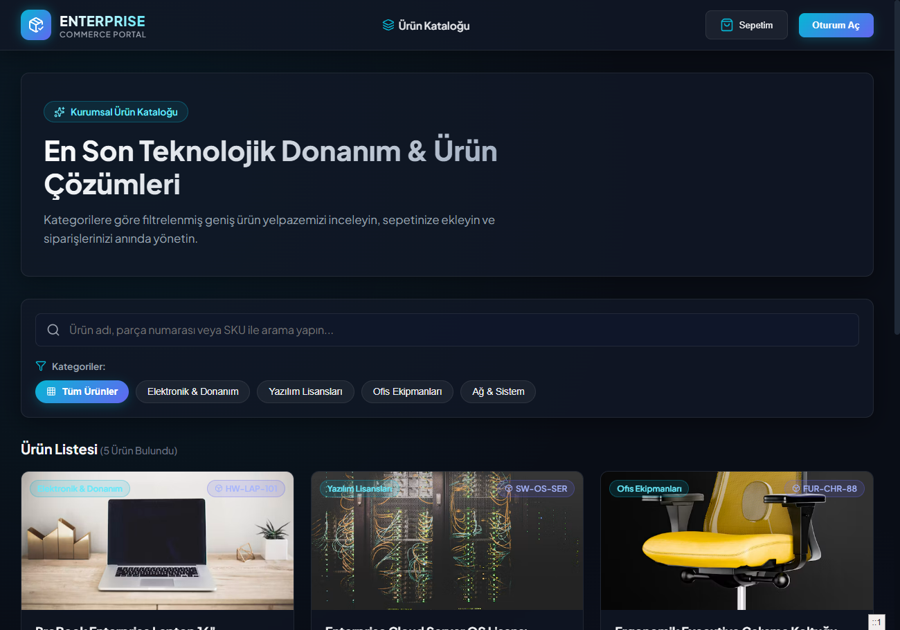
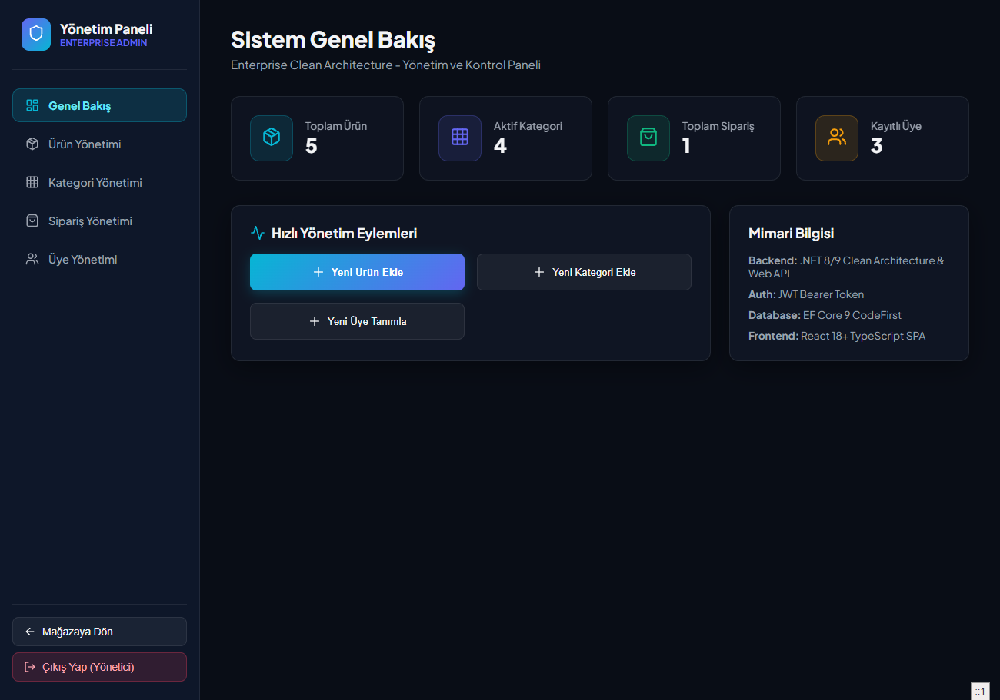
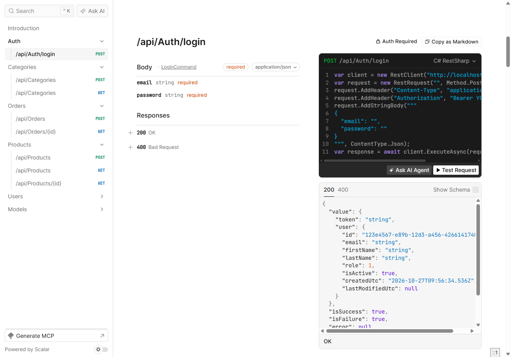
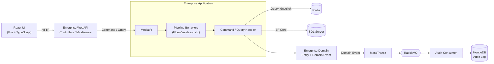

# Enterprise Clean Architecture (.NET 9 & React)

[](https://github.com/msbeden/enterprise-clean-architecture-net/actions/workflows/ci.yml)
[](LICENSE)


Kurumsal ölçekli bir projede **Clean Architecture** ve **Domain-Driven Design (DDD)** pratiklerinin nasıl uygulanacağını göstermek amacıyla geliştirdiğim uçtan uca bir referans proje.

Backend tarafında modern **.NET 9 Web API**, ön yüzde ise **React (Vite + TypeScript)** ile hazırlanmış hem müşteri vitrini hem de temel bir yönetim paneli yer alıyor.

---

## 💡 Neden Bu Mimariyi Seçtim?

Geleneksel N-tier projelerde zamanla iş mantığı ile veritabanı katmanının iç içe geçmesi ve spagetti kod oluşması sık karşılaşılan bir problem. Bu projede bu sorunu aşmak için:

- **Saf Domain:** `Enterprise.Domain` katmanını hiçbir harici ORM ya da kütüphaneye bağımlı kılmadan, saf C# varlıkları, value object'ler ve domain event'leri ile kurguladım.
- **CQRS & MediatR:** İş akışlarını şişkin `Service` sınıfları yerine bağımsız `Command` ve `Query` parçalarına böldüm. Her use-case kendi validasyonunu (FluentValidation) ve pipeline davranışını işletiyor.
- **Dağıtık Altyapı:**
  - Sık okunan veriler için **Redis** dağıtık önbellekleme,
  - Sistem içi gevşek bağlılık (loose coupling) için **MassTransit (RabbitMQ)** olay yönetimi,
  - İlişkisel veritabanını denetim kayıtlarıyla yormamak için **MongoDB** tabanlı audit-log servisi tercih edildi.
- **Açık ve Hızlı Dokümantasyon:** Swagger UI yerine daha modern ve performanslı olan **Scalar** kullanıldı.

---

## 📸 Ekran Görüntüleri

| Vitrin                                    | Yönetim Paneli                           |
| ----------------------------------------- | ---------------------------------------- |
|  |  |



## 🏗️ Katman Yapısı

```text
src/
├── Core/
│   ├── Enterprise.Domain        # Varlıklar, Value Object'ler, Domain Event'leri (Saf C#)
│   └── Enterprise.Application   # CQRS (MediatR), DTO'lar, Pipeline Behavior'lar, Arayüzler
├── Infrastructure/
│   ├── Enterprise.Persistence   # EF Core DbContext, Fluent Configurations, Migration'lar
│   └── Enterprise.Infrastructure# Redis, MassTransit/RabbitMQ, JWT, Mongo Audit Logger
└── Presentation/
    ├── Enterprise.WebAPI        # Minimal API/Controllers, Middleware, Scalar API Explorer
    └── Enterprise.WebUI         # React 18, TypeScript, Tailwind CSS vitrin ve yönetim arayüzü
```

## 🔄 İstek Akışı



---

## 🚀 Hızlı Başlangıç

### Gereksinimler

- [.NET 9 SDK](https://dotnet.microsoft.com/download)
- [Node.js 20+](https://nodejs.org/)
- [Docker Desktop](https://www.docker.com/)

### 1. Docker Compose ile Tek Adımda Çalıştırma

Tüm bağımlılıkları (SQL Server, Redis, RabbitMQ, Mongo, API ve React UI) tek komutla ayağa kaldırabilirsiniz:

```bash
docker compose up -d
```

> **Geliştirici Notu:** SQL Server konteynerinin tam hazır hale gelmesi ilk çalıştırmada makinenizin hızına bağlı olarak 10-15 saniye sürebilir. API konteyneri otomatik retry mekanizmasıyla migration'ları ve seed verileri basacaktır.

Servis adresleri:

- **Web UI:** [http://localhost:3000](http://localhost:3000)
- **Web API:** [http://localhost:8080](http://localhost:8080)
- **API Dokümantasyonu (Scalar):** [http://localhost:8080/scalar/v1](http://localhost:8080/scalar/v1)

### 2. Yerel Geliştirme (Local Development)

Sadece altyapıyı Docker'da çalıştırıp API ve UI'ı yerel makinenizde koşturmak isterseniz:

```bash
# 1. Altyapıyı başlatın
docker compose up -d sqlserver redis rabbitmq mongodb

# 2. Web API'yi başlatın
dotnet run --project src/Presentation/Enterprise.WebAPI

# 3. Frontend'i başlatın (farklı bir terminal penceresinde)
cd src/Presentation/Enterprise.WebUI
npm install
npm run dev
```

---

## 🔑 Test Kullanıcıları (Seed Verisi)

Sistemi ilk kez başlattığınızda test yapabilmeniz için aşağıdaki kullanıcılar otomatik tanımlanır:

- **Admin:** `admin@enterprise.com` / `Admin123!`
- **Müşteri:** `customer@enterprise.com` / `Customer123!`

---

## 🧪 Testleri Çalıştırma

Domain kuralları, CQRS handler'ları ve WebApplicationFactory tabanlı API entegrasyon testlerini koşturmak için:

```bash
dotnet test
```

---

## 📌 Yol Haritası & İleride Eklenebilecekler

- [ ] Outbox Pattern ile mesaj kuyruğu garanti teslim mekanizması
- [ ] OpenTelemetry, Prometheus ve Grafana panelleri
- [ ] Playwright ile uçtan uca (E2E) UI testleri

---

> **Not:** Windows üzerinde Docker Desktop kullanırken RAM limitinizin en az 4GB olduğundan emin olun.

## 📄 Lisans

Bu proje [MIT](LICENSE) lisansı altında geliştirilmiştir.
